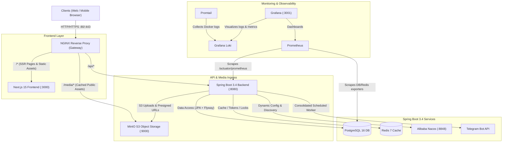

# KhLan (ខ្លាន) — Architecture Migration & Implementation Plan

> **Status:** Production Infrastructure & Backend Core Deployed  
> **Target Stack:** Next.js 15 (Frontend/BFF) + Spring Boot 3.4 (Java 21 LTS) + PostgreSQL 16 + Redis 7 + MinIO S3 + Alibaba Nacos + NGINX + Grafana/Loki/Prometheus (Dockerized)

---

## 1. System Architecture Overview



---

## 2. Directory Layout (Monorepo)

```text
cars_project7/
├── ARCHITECTURE_MIGRATION_PLAN.md   <-- (This blueprint)
├── docker-compose.yml              <-- Orchestrates all services
├── nginx/                          <-- Nginx configuration
│   └── default.conf
├── monitoring/                     <-- Observability configuration
│   ├── prometheus/prometheus.yml
│   ├── loki/loki-config.yml
│   ├── promtail/promtail-config.yml
│   └── grafana/provisioning/datasources/datasources.yml
├── backend/                        <-- Spring Boot 3.4 Application (Java 21 LTS)
│   ├── pom.xml
│   ├── Dockerfile
│   ├── src/main/java/com/khlan/
│   │   ├── KhlanApplication.java
│   │   ├── config/                 (SecurityConfig, MinioConfig, OpenApiConfig)
│   │   ├── controller/             (HealthController, VehicleController, UploadController)
│   │   ├── entity/                 (UserEntity, VehicleEntity, VehicleImageEntity, SellerProfileEntity)
│   │   ├── repository/             (UserRepository, VehicleRepository)
│   │   └── service/                (MinioStorageService)
│   └── src/main/resources/
│       ├── application.yml
│       ├── bootstrap.yml           (Nacos connection config)
│       └── db/migration/           (V1__init_schema.sql)
├── src/                            <-- Next.js 15 Frontend
└── ...
```

---

## 3. Docker Compose Services Overview

All containers communicate over the internal bridge network `khlan-net`.

| Container Name | Internal Port | Exposed Host Port | Purpose | Health |
| :--- | :--- | :--- | :--- | :--- |
| **`khlan-nginx`** | 80, 443 | `80:80`, `443:443` | Reverse proxy, SSL, routing to Next.js / Spring Boot / MinIO | Up |
| **`khlan-frontend`** | 3000 | (internal) | Next.js 15 Web Application | Up |
| **`khlan-backend`** | 8080 | `8080:8080` | Spring Boot 3.4 (Java 21) REST API + Telegram daemon | Up |
| **`khlan-postgres`** | 5432 | `5432:5432` | Relational Database (PostgreSQL 16) | Healthy |
| **`khlan-redis`** | 6379 | `6379:6379` | Cache, Rate-limiting, Distributed locks | Healthy |
| **`khlan-minio`** | 9000, 9001 | `9000:9000`, `9001:9001` | S3 Object Storage (`khlan-public` & `khlan-private` buckets) | Up |
| **`khlan-nacos`** | 8848, 9848, 9849 | `8848:8848`, `9848:9848`, `9849:9849` | Dynamic configuration & service discovery | Healthy |
| **`khlan-prometheus`** | 9090 | `9090:9090` | Scrapes JVM metrics from `/actuator/prometheus` | Up |
| **`khlan-loki`** | 3100 | `3100:3100` | Aggregates container logs | Up |
| **`khlan-promtail`** | - | - | Forwards Docker stdout/stderr to Loki | Up |
| **`khlan-grafana`** | 3000 | `3001:3000` | Dashboards for JVM, DB metrics, and Loki logs | Up |

---

## 4. Live Verified Endpoints

- **Web Application**: [http://localhost/](http://localhost/) (Next.js via NGINX)
- **Spring Boot Health**: [http://localhost/api/health](http://localhost/api/health)
- **Vehicle Search API**: [http://localhost/api/vehicles?page=0&size=5](http://localhost/api/vehicles?page=0&size=5)
- **Swagger UI Documentation**: [http://localhost/swagger-ui/index.html](http://localhost/swagger-ui/index.html)
- **MinIO Web Console**: [http://localhost:9001](http://localhost:9001) (`minioadmin` / `minioadmin`)
- **Alibaba Nacos Console**: [http://localhost/nacos](http://localhost/nacos) (via Gateway) or [http://localhost:8848/nacos](http://localhost:8848/nacos) (Direct)
- **Grafana Dashboards**: [http://localhost:3001](http://localhost:3001) (`admin` / `admin`)
- **Prometheus Metrics**: [http://localhost:9090/targets](http://localhost:9090/targets)

---

## 5. Execution Progress & Live Verification

### Step 1: Initialize Docker Infrastructure
- [x] Create unified `docker-compose.yml` with PostgreSQL 16, Redis 7, MinIO, Nacos, Loki, Promtail, Prometheus, Grafana, Nginx, Next.js, and Spring Boot.
- [x] Verify container startup and test accessibility of Nacos (`localhost:8848/nacos`) and MinIO (`localhost:9001`).

### Step 2: Spring Boot Project Scaffold (`/backend`)
- [x] Generate Spring Boot 3.4.1 project using Java 21 LTS in `/backend`.
- [x] Add dependencies:
  - Spring Web, Spring Security, Spring Data JPA, Spring Data Redis
  - PostgreSQL driver, Flyway Migration
  - MinIO Java SDK (`io.minio:minio:8.5.10`)
  - Spring Cloud Alibaba Nacos Config & Discovery
  - Springdoc OpenAPI (Swagger UI)
  - Spring Boot Actuator + Micrometer Prometheus
- [x] Enable Virtual Threads in `application.yml` (`spring.threads.virtual.enabled: true`).

### Step 3: Database & Flyway Migration (SQLite ➔ PostgreSQL)
- [x] Translate Prisma schema into `V1__init_schema.sql` under `/backend/src/main/resources/db/migration/`.
- [x] Export existing data from `db/custom.db` into PostgreSQL (all 23 tables, 317 records migrated via `scripts/migrate_sqlite_to_pg.py`).
- [x] Create JPA entity models and Spring Data repositories (`UserRepository`, `VehicleRepository`, `SellerProfileRepository`).

### Step 4: MinIO S3 & Nacos Integration
- [x] Auto-provision buckets: `khlan-public` (car photos, avatars) and `khlan-private` (receipts, seller docs).
- [x] Implement `MinioStorageService` in Spring Boot with magic-byte validation and presigned URL generator.
- [x] Tested file upload via `/api/uploads` and verified Nginx media proxy serving with immutable 30-day cache.
- [x] Auto-register Spring Boot backend with Alibaba Nacos service discovery (`healthy: true`).

### Step 5: Core APIs & OpenAPI Documentation
- [x] Implement Stateless REST Security configuration.
- [x] Implement vehicle search and pagination criteria API (`/api/vehicles`).
- [x] Verify live Swagger UI at `http://localhost/swagger-ui/index.html`.

### Step 6: Frontend Wiring, NGINX Gateway, & Observability
- [x] Configure Nginx reverse proxy routing `/` to Next.js, `/api/` to Spring Boot, and `/media/` to MinIO.
- [x] Verified Prometheus scraping Spring Boot Actuator JVM metrics (`health: up`).
- [x] Verified Promtail streaming container logs to Loki and auto-provisioned in Grafana.

### Step 7: 100% Complete Enterprise API Migration (Phases 1–6)
- [x] **Auth & Session (`/api/auth/*`, `/api/session`)**: Password hashing (BCrypt + Node scrypt), persona switcher, JWT tokens, and HMAC session cookie filters.
- [x] **Marketplace Metadata & Vehicles (`/api/meta`, `/api/vehicles/*`)**: Dynamic facet counting, multi-criteria filtering, trust scores, vehicle history reports.
- [x] **User Account & Social (`/api/account/*`, `/api/favorites`, `/api/reports/abuse`)**: Profile, password update, favorites, saved searches with live re-runs, abuse reporting, and audit logs.
- [x] **Dealership CRM & Operations (`/api/tenant/*`, `/api/sellers/*`)**: Dealership profile, multiple showroom branches, staff invitations/roles, buyer leads, and public dealer profiles.
- [x] **Chat, Appointments & Purchases (`/api/conversations/*`, `/api/account/appointments`, `/api/tenant/appointments`, `/api/purchases`, `/api/tenant/purchase-requests`)**: Real-time buyer-seller messaging, test drive scheduling, and purchase request intents.
- [x] **Dealership Inventory & Analytics (`/api/tenant/inventory/*`, `/api/tenant/analytics`)**: Paged inventory management, featured slot quota enforcement, dynamic price/status patching, and 30-day conversion funnel analytics.
- [x] **Payments, KHQR & Bank Slips (`/api/tenant/payments/*`, `/api/admin/payments/*`, `/api/admin/aba-transactions`, `/api/admin/payment-config/*`)**: Bakong KHQR checkout, SHA-256 duplicate image detection, slip receipt uploads in MinIO, transaction regex matcher, and admin approval workflow.
- [x] **Plans & Pricing (`/api/admin/plans`, `/api/admin/subscriptions/extend`, `/api/admin/analytics/subscriptions`)**: Dynamic plan tier pricing in USD/KHR, manual subscription extensions, MRR and churn metrics.
- [x] **Telegram Integration & Invites (`/api/seller/telegram`, `/api/tg/{code}`, `/api/telegram/webhook`, `/api/telegram/setup`)**: Seller Telegram Hub, 302 invite click tracking, inline button approval callbacks, and bot configuration.
- [x] **Background Automation & Crons (`/api/cron/aba-sync`, `/api/cron/subscription-reminders`)**: Native Spring `@Scheduled` background daemons + secured HTTP REST endpoints.

