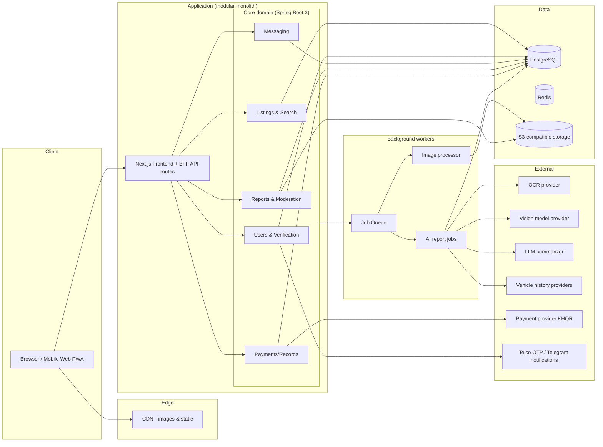
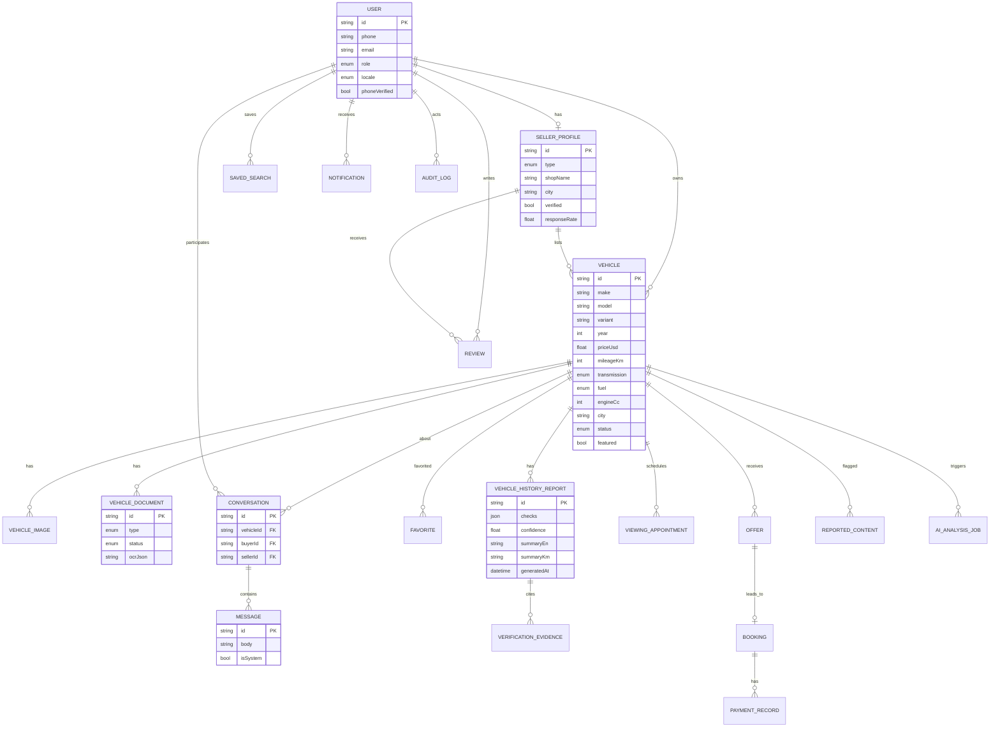

# KhLan (ខ្លាន) — AI-Powered Car Marketplace for Cambodia
## Development Plan v1.0

> **Reading guide:** Every market claim in this document is tagged **[FACT — verify]** (widely reported public knowledge that must still be re-verified with current sources before launch), **[ASSUMPTION]** (hypothesis to validate with users), or **[RECOMMENDATION]**. No market size, competitor, or pricing figures are presented as verified data.

---

## 1. Executive Summary

**The problem.** Buying a used car in Cambodia today means navigating fragmented channels — Facebook groups, dealer pages, word of mouth — where buyers cannot reliably verify vehicle identity, ownership documents, mileage, accident history, or seller credibility. Sellers, especially small dealers, struggle to reach serious buyers and to differentiate themselves from scammers.

**The product.** KhLan (ខ្លាន, "Khmer car") is a mobile-first online marketplace for buying and selling cars in Cambodia, launched in Phnom Penh. It combines:

- A modern listings marketplace (search, filters, comparisons, secure messaging).
- **Evidence-based AI vehicle reports** that clearly separate *verified records*, *evidence found*, *inconsistencies*, *not verified*, and *no data available* — never presenting "no records found" as "no accidents."
- Seller/vehicle verification badges with plain-language explanations of what each badge means.
- Khmer-first UI with full English support, USD pricing with KHR display.

**The unique selling proposition (USP).** *Trust as a feature, not a slogan.* KhLan is the marketplace where every claim has a visible evidence status. This is deliberately more honest — and more defensible — than an "AI score" without provenance.

**Business model (hypotheses to validate).** Free basic listings → paid featured listings → dealer subscriptions → paid AI reports → advertising. The smallest sustainable testable model is **featured listings + a small dealer subscription** (see §13).

**Expected value.** For buyers: faster, safer decisions and fewer wasted viewings. For dealers: higher-quality leads and differentiated storefronts. For the business: commission-free marketplace revenue with low escrow/regulatory exposure at MVP stage (the platform does not hold customer funds initially).

---

## 2. Business Opportunity & Cambodian Market Research

### 2.1 Market context (to be validated in Phase 0)

| Topic | Current understanding | Tag |
|---|---|---|
| Vehicle supply | Cambodia has no domestic car manufacturing; the market is dominated by **used imports** (USA, South Korea, Japan, Thailand; growing Chinese EV share). This creates heterogeneous vehicle histories and strong documentation risk. | [FACT — verify] |
| Buyer segments | Affluent individuals & families (SUVs: Land Cruiser, Lexus RX series, Prado), small-business/commercial buyers (pickups: Hilux/Revo, Ranger), expatriates, ride-hailing drivers (budget sedans). | [FACT — verify] |
| Popular vehicles | Toyota (Land Cruiser, Prado, Camry, Corolla, Hilux Revo), Lexus (RX 330/350/400h), Honda (CR-V, Civic, Fit), Ford (Ranger, Everest), Hyundai, Kia, Mercedes (older S/E-class). | [FACT — verify] |
| Dominant channels | **Facebook** (groups, pages, Marketplace) is the primary place cars are advertised today; Telegram groups and TikTok are growing. Dedicated car classified sites exist but are generally weaker than social channels. | [FACT — verify] |
| Payments | Cash remains king for vehicle transactions. **KHQR** (Bakong, National Bank of Cambodia) is the national QR payment standard and is accepted across banks/apps (ABA, Wing, ACLEDA, TrueMoney, etc.). Banks are integrating KHQR widely. Escrow-style services for used cars are not assumed to exist. | [FACT — verify] |
| Trust concerns | Odometer tampering, flood/accident damage concealment, forged registration ("book"), import-doc inconsistencies, fake sellers, advance-deposit scams. Buyers mitigate by bringing a trusted mechanic. | [FACT — verify] |
| Regulation | E-commerce, consumer protection, and electronic transactions laws exist in Cambodia (e.g., E-Commerce Law, Consumer Protection Law); payment services are regulated by NBC. Specific obligations for a marketplace must be confirmed by local counsel (§12). | [FACT — verify] |

**Do not rely on this table as final research.** Phase 0 must re-verify each row via official sources (Ministry of Commerce, NBC/banks, GDCE for import rules), bank documentation, and primary interviews.

### 2.2 Competitor landscape (structure, not statistics)

- **Facebook groups/pages & Marketplace:** massive reach, zero verification, high scam prevalence, poor search/discovery. Strength: where everyone already is. Weakness: trust, organization, no reports.
- **Established local classified sites** (names and current status to be confirmed in Phase 0): listing directories, weak trust features, desktop-era UX.
- **Dealer ecosystems:** dealers self-publish on Facebook; some run their own simple websites with no verification.
- **Informal inspection services:** independent mechanics; no standardized consumer-facing reports.

**Differentiation opportunity [RECOMMENDATION]:** trust infrastructure (evidence-based AI reports, verification badges with honest definitions, moderation), mobile-first Khmer UX, and a listing experience designed for phones — none of which Facebook groups provide.

### 2.3 Launch strategy (limited budget)

1. **Supply first, city-first.** Recruit 15–30 Phnom Penh dealers + private sellers manually; personally photograph and help list their cars. Target ≥100 quality listings before public launch.
2. **Free everything at first.** No listing fees; introduce paid features only after sellers get demonstrable leads.
3. **Facebook as top-of-funnel.** Every listing gets a shareable card for Facebook/Telegram; the platform is where *serious* filtering and reports live.
4. **Trust content marketing.** Khmer-language guides ("how to check a car book", "KHQR payment safety", "10 signs of rolled-back mileage") to build SEO and brand trust cheaply.

---

## 3. Product Goals & Measurable Objectives

| # | Goal | Objective (baseline-setting, not invented benchmark) |
|---|---|---|
| G1 | Trusted listings | ≥60% of active listings have ≥1 verified document item or AI report within 6 months of launch; measure: DB share. |
| G2 | Usable discovery | Median search-to-detail time <2 min; search-to-detail conversion ≥25% (instrument from day 1; treat first month as baseline). |
| G3 | Active connections | Buyer inquiry rate ≥8% of detail views; seller response within 24h ≥70%. |
| G4 | Mobile performance | LCP <2.5s on mid-range Android over 3G Fast profile (Lab + RUM). |
| G5 | Honest AI | ≥0 fabricated-status incidents in audit sampling; report dispute rate <2%; 100% of reports show evidence status + limitations. |
| G6 | Viable economics | ≥5 paying dealers within 90 days of monetization pilot; featured-listing attach rate ≥3% of new listings. |

---

## 4. Target Users & User Journeys

### 4.1 User groups

| Group | Needs | Frustrations | KhLan benefit |
|---|---|---|---|
| **Buyers (individuals/families)** | Honest condition info, fair price guidance, safe contact, documents check | Scams, wasted trips, unreadable histories | AI reports, verified badges, safe-messaging, inspection reminders |
| **Private sellers** | Fast listing, serious buyers, safety | Time-wasters, lowballers, scam messages | Multi-step mobile listing, lead quality, safety guardrails |
| **Dealers** | Inventory management, storefront branding, qualified leads | Facebook clutter, duplicate work, brand theft | Dealer storefront, dashboard, verified badge, analytics |
| **Inspection partners** | Demand for inspections, standardized output | Ad-hoc requests | Inspection booking flow, standardized report format (Phase 4+) |
| **Admins/support** | Moderation efficiency, fraud detection | Manual review load | Moderation queue, reports, audit logs, anomaly flags |

### 4.2 Core journeys (simplified)

1. **Buyer searches** → home search or filters → results grid (mobile: bottom-sheet filters) → detail.
2. **Buyer compares** → favorite 2–4 cars → comparison view (specs + price + report status side-by-side).
3. **Buyer requests AI report** → report page: per-check evidence statuses, confidence, limitations → shares with mechanic.
4. **Buyer contacts seller** → in-platform message (templates provided) → viewing appointment → safety tips shown (never pay before seeing documents & car).
5. **Private seller lists a car** → phone-number login → 3-step guided form (details → photos/condition → price/contact) → moderation → published notification.
6. **Dealer manages inventory** → dealer dashboard → bulk listing status, lead inbox, storefront editor.
7. **Admin reviews flagged content** → moderation queue sorted by risk score → approve/reject with reason → audit log.

**Removed friction [RECOMMENDATION]:** no account required to browse/search; listing creation reachable in ≤3 taps from anywhere; no email verification required when phone OTP available; inquiry without forced signup (phone-callback request) in MVP testing.

---

## 5. Feature Matrix

| Feature | MVP (launch) | Phase 2 | Future |
|---|---|---|---|
| Email/phone auth, roles (buyer/seller/dealer/admin) | ✅ phone-first | OTP verification | Social login |
| Listing CRUD + moderation queue | ✅ | Duplicate detection, auto-flagging | Bulk dealer imports |
| Photos (multi-upload, compress) | ✅ | Video | 360° photos |
| Search + filters + sort | ✅ | Saved searches, alerts | NLP search (Khmer/English) |
| Vehicle detail page | ✅ | Recently viewed | Price estimation |
| Favorites | ✅ | Cross-device sync | — |
| In-platform messaging | ✅ | Response-rate stats, block/report automation | Voice notes |
| AI vehicle report (evidence-based) | ✅ rules + OCR + photo observations | Data-provider integrations | Damage-cost estimation |
| Seller verification | ✅ manual review | Automated doc checks | Business registry lookup |
| Dealer storefront | Basic | ✅ full dashboard | CRM, inventory import |
| Featured listings / subscriptions | — | ✅ | — |
| Payments (KHQR deep links, records only) | Records only | ✅ provider integration | Escrow (after legal review) |
| Reviews & ratings | Seller ratings | Verified-transaction reviews | — |
| Comparisons | ✅ (up to 4) | Smart summaries | — |
| Notifications | In-app | ✅ Telegram/email | Push |
| Admin dashboard | ✅ basic | Risk scoring | — |
| i18n Khmer/English | ✅ | ✅ RTL-safe patterns | — |

---

## 6. AI Vehicle History & Inspection Architecture

### 6.1 Core principle

> **The AI analyzes available evidence; it never invents missing history.** "No records found" ≠ "No accidents". Every statement in a report carries one of five statuses: **VERIFIED_BY_SOURCE · EVIDENCE_FOUND · POTENTIAL_INCONSISTENCY · NOT_VERIFIED · NO_DATA** — plus source reference, date, and confidence.

### 6.2 Vehicle identification

- Accept **VIN/chassis number**, registration book photos, plate, make/model/year.
- Distinguish and label: chassis/VIN (stamped ID), plate (reassignable), registration book (ownership doc). Handle missing/invalid/duplicate IDs by downgrading all identity checks to NOT_VERIFIED with explanation, never guessing.

### 6.3 Data sources & feasibility (honest assessment)

| Source | Feasibility | Notes |
|---|---|---|
| Cambodian government registration records | **Unknown — must be researched/negotiated**; do not assume an API exists | Phase 0 legal/technical assessment; likely bilateral agreement, not open API |
| International history providers (Carfax/AutoCheck-type) | Only for imported vehicles with foreign VINs; **commercial licensing required**; coverage for US/KR/JP imports varies | Evaluate per-import-market; cost per report |
| Dealer maintenance records | Seller-submitted; verify format/content | OCR-assisted |
| Inspection centers | Partner-dependent | Phase 4+ |
| Marketplace-internal history (previous listings, photos, price changes) | Fully available | Strong duplicate/tamper signals |
| Seller documents (registration book, import docs) | Available at listing time | OCR + consistency rules |

### 6.4 Report generation pipeline (MVP)

```
Input: listing fields + documents (images) + photos + price/mileage
  ├─ Rules engine (deterministic): field consistency, mileage-vs-age sanity,
  │   price-vs-segment anomaly, doc presence/completeness, duplicate image hash,
  │   listing-text risk patterns (e.g., "deposit first")
  ├─ OCR (documents): extract registration/import doc fields → cross-check
  │   VIN/plate/name/engine vs listing → INCONSISTENCY or EVIDENCE_FOUND
  ├─ Vision model (photos): visible damage observations, mismatched photos,
  │   plate/VIN readability — always phrased as observations, not conclusions
  └─ LLM (summarizer): bilingual (KM/EN) plain-language summary of the
      *check results only* — no new claims, JSON-structured output
Output: VehicleHistoryReport { checks[], summary, confidence, limitations[], sources[], generatedAt }
```

**Model strategy [RECOMMENDATION]:** hybrid — deterministic rules in code, commercial OCR/Vision APIs behind a **provider-abstraction interface**, LLM only for summarization. No proprietary model training without lawful labeled data. Cache reports; regenerate on material listing edits.

### 6.5 Safety & quality controls

Consent before document upload processing · PII masking (owner names, ID numbers) in stored extractions · encrypted storage for docs · report access restricted to requester + seller + admin · audit events on every report view/generation · confidence display · low-confidence → human review queue · dispute/correction flow · UI copy that never implies verification guarantees quality.

**MVP honesty scope:** launch with document consistency, listing anomaly detection, duplicate detection, and photo observations. Add external data integrations only when contracts are confirmed.

---

## 7. UI/UX Design System

**Feel:** premium automotive, calm, trustworthy. Light theme default; dark mode later.

- **Colors:** near-black `#111827`-family slate for text/headers; **amber/gold** primary CTA (automotive premium cue, distinct from Facebook blue); emerald = verified; amber = inconsistent; neutral gray = not verified / no data. No decorative gradients on data.
- **Typography:** `Inter` for Latin; **`Kantumruy Pro` / Noto Sans Khmer** for Khmer; ≥16px body, generous line-height for Khmer ascenders/descenders (broken-rendering tests in QA).
- **Components:** shadcn/ui-based library: `VehicleCard`, `StatusBadge`, `SpecGrid`, `Gallery`, `FilterSheet`, `StepForm`, `EvidenceChecklist`, `TrustExplainer`.
- **Principles:** mobile-first (single column, bottom-sheet filters, sticky CTA bar on detail), skeleton loading everywhere, ≤150KB critical path images (AVIF/WebP + CDN), helpful empty states with next actions, forms ≤5 fields per step, no animations that block interaction.
- **Advertising separation:** sponsored cards visually labeled; AI-generated content labeled "AI-assisted assessment — evidence status shown per item".

**Key pages (spec summary):** Home (hero search + categories + featured + new arrivals + trust explainer) · Results (filter rail/bottom-sheet, sort, result count, empty state) · Detail (gallery, price+KHR, spec grid, docs status, seller card with badges, safety box, report CTA, similar cars) · AI Report (summary, evidence checklist with 5 statuses, confidence, limitations, dispute link) · Compare (up to 4) · Seller storefront · 3-step Sell form · Buyer dashboard (favorites, inquiries) · Dealer dashboard (inventory, leads) · Messaging (threads + safety reminders) · Admin moderation queue. *(Full Figma prototyping of journeys 1–5 from §4 before Phase 2 build.)*

---

## 8. Technology Stack Recommendation

| Layer | Recommendation | Rationale | Alternatives considered |
|---|---|---|---|
| Frontend | **Next.js 16 (App Router) + TypeScript + Tailwind CSS + shadcn/ui** | One language across stack, SSR/SEO for listings, fast team velocity, huge hiring pool | Nuxt/Vue, plain React SPA (weaker SEO) |
| i18n | **next-intl** or lightweight dictionary (MVP) | Khmer/EN from day one | i18next |
| Backend | **Modular monolith**: Next.js API routes for BFF + **Java 21 / Spring Boot 3** service for core domain as it grows | Start fast; clear module boundaries (listings, search, reports, messaging, moderation) let Spring Boot absorb domain logic later without rewrite | Node/NestJS (fine alternative if team is JS-only) |
| Data | **PostgreSQL** (transactional), Redis (cache/queues when needed) | Relational integrity for listings/reports; JSONB for flexible evidence payloads | SQLite (MVP/dev only), MongoDB |
| Files | **S3-compatible object storage** + CDN | Cheap image/doc hosting, signed URLs for private docs | Disk on VPS (short-term fallback) |
| Jobs | Queue (BullMQ/Redis or cloud tasks) for AI reports, image processing, notifications | Keeps request latency low | Cron (MVP fallback) |
| AI | Commercial OCR + Vision APIs behind abstraction; LLM summarizer | Best accuracy/cost tradeoff; vendor swap possible | Self-hosted models (later, cost-driven) |
| Docs | OpenAPI spec for public/internal APIs | Contract-first, enables mobile later | — |
| DevOps | Docker + GitHub Actions CI/CD; managed Postgres; error tracking (Sentry); backups; staging env | Reproducible, low ops burden | — |

**Hosting [RECOMMENDATION]:** Singapore-region managed cloud (closest major region to Cambodia with strong managed offerings) + CDN edge for images; self-hosting on a local VPS is a viable later optimization for latency, not for MVP.

**Avoid in MVP:** Kubernetes, microservices, streaming infra, custom ML training.

---

## 9. System Architecture (Mermaid)



---

## 10. Data Model & ERD (Mermaid)

Core entities (adjusted to avoid duplication): User, UserRole (enum on User), SellerProfile (covers private+dealer via type), Vehicle (specs embedded), VehicleImage, VehicleDocument, VehicleListing merged into Vehicle.status, VehicleHistoryReport, VerificationEvidence, AIAnalysisJob, Conversation, Message, Favorite, SavedSearch, ViewingAppointment, Offer, Booking, PaymentRecord, Review, Notification, ReportedContent, AuditLog.



**Key constraints:** unique VIN-per-active-listing check (soft), `Vehicle.status ∈ {DRAFT, PENDING_REVIEW, PUBLISHED, REJECTED, SOLD, ARCHIVED}`, report access control at service layer, AuditLog on all moderation/payment/report events.

---

## 11. Representative REST API Design

Conventions: JSON, cursor pagination (`?cursor=&limit=`), RFC7807-style errors `{code, message, details}`, JWT bearer auth, role-based access, idempotency keys on payments.

| Method | Path | Auth | Notes |
|---|---|---|---|
| POST | `/api/auth/request-otp` `{phone}` | public | rate-limited |
| POST | `/api/auth/verify-otp` `{phone, code}` → `{token, user}` | public | |
| GET | `/api/vehicles?make=&priceMin=&priceMax=&yearMin=&fuel=&trans=&city=&sellerType=&verified=&sort=newest\|price_asc\|price_desc&cursor=` | public | `VehicleCard[]` + `nextCursor` |
| POST | `/api/vehicles` | seller/dealer | creates DRAFT |
| GET | `/api/vehicles/:id` | public | detail + images + docsStatus + seller summary |
| PATCH | `/api/vehicles/:id` | owner/admin | triggers re-moderation on material fields |
| POST | `/api/vehicles/:id/report` | any user (consent flag) | creates AIAnalysisJob → 202 `{jobId}` |
| GET | `/api/reports/:id` | requester/seller/admin | full evidence report |
| POST | `/api/conversations` `{vehicleId, message}` | buyer | starts thread |
| GET | `/api/conversations/:id/messages?cursor=` | participant | |
| POST | `/api/favorites` / `DELETE /api/favorites/:vehicleId` | user | |
| POST | `/api/reports/abuse` `{vehicleId, reason}` | user | → moderation queue |
| GET | `/api/admin/moderation?status=PENDING` | admin | risk-sorted queue |

Example — `GET /api/vehicles?make=Toyota&priceMax=30000&sort=price_asc`:

```json
{
  "items": [{
    "id": "veh_01J...",
    "make": "Toyota", "model": "Land Cruiser Prado", "year": 2018,
    "priceUsd": 28500, "mileageKm": 92000,
    "city": "Phnom Penh", "sellerType": "DEALER",
    "thumbnail": "https://cdn.../p1.avif",
    "trust": { "sellerVerified": true, "docsProvided": 3, "reportAvailable": true }
  }],
  "nextCursor": "eyJ..."
}
```

---

## 12. Security & Regulatory Checklist

**Security [RECOMMENDATION]:** input validation everywhere (zod) · rate limiting (OTP, messaging, report requests) · secure session/JWT handling · RBAC middleware · object-storage signed URLs for private docs · encryption at rest for documents/PII · audit logs · dependency scanning · backups + restore drills · abuse tooling (block/report) · incident-response runbook · pen-test before launch.

**Regulatory — questions for qualified Cambodian counsel (do not assume answers):**
1. E-commerce/online business registration requirements and licensing for a marketplace operator (Ministry of Commerce).
2. Consumer protection & advertising law obligations for listing content and "verified"/"AI report" claims.
3. Electronic transactions law: validity of electronic records/contracts, data-retention expectations.
4. Personal data protection obligations (Cambodia's data protection framework — confirm current law/sub-decree status & scope) for IDs, documents, phone numbers.
5. Payment: rules for facilitating payments/KHQR collection; **confirm escrow would constitute a regulated activity** (treat as out-of-scope until cleared).
6. Vehicle-history data: legality of processing registration-book images; any restrictions on government data use.

---

## 13. Monetization & Financial Scenarios

**All figures below are hypotheses to validate — not market data.**

| Stream | MVP | Model | Illustrative pricing (validate!) |
|---|---|---|---|
| Free basic listings | ✅ | acquisition | $0 |
| Featured listing | Phase 2 | per-listing boost, 7 days | $3–10 |
| Dealer subscription | Phase 2 | storefront + dashboard + badge | $19 / $49 / $99 per month tiers |
| Paid AI report | Phase 3 | per report | $1.5–4 (first one free per vehicle) |
| Advertising | Phase 4 | CPM banners | market-rate |
| Inspection referral | Phase 4 | partner commission | per booking |
| Qualified buyer leads | Phase 4 | per lead (opt-in only) | per-lead fee |

**Scenarios (illustrative, year-1, 6 months live — validate every assumption):**

| Scenario | Active listings | Paying dealers | Featured attach | MRR |
|---|---|---|---|---|
| Conservative | 300 | 5 | 2% | ≈ $400–600 |
| Base | 800 | 15 | 3% | ≈ $1,300–1,900 |
| Optimistic | 2,000 | 40 | 5% | ≈ $4,000–5,500 |

**Smallest sustainable test [RECOMMENDATION]:** 10 paying dealers on a $19–29 plan + featured listings. That validates willingness-to-pay before any heavy AI-infrastructure spend.

---

## 14. Phased Development Roadmap

Assumed team: 1 founder/PM, 2 full-stack engineers, 1 part-time designer, 1 part-time QA. Solo developer ≈ 1.8–2× duration.

| Phase | Weeks | Deliverables | Exit criteria (measurable) |
|---|---|---|---|
| **0 Discovery & validation** | 4 | 20 seller + 15 buyer interviews; competitor teardown; data-provider feasibility memo; legal questions sent to counsel; clickable prototype tested with 8 users | Go/no-go memo; ≥60% of interviewed dealers say they would list; data-provider decision |
| **1 Foundation** | 4 | Repo/CI/CD, design system, auth (phone-first), RBAC, DB schema, i18n skeleton, OpenAPI conventions | Deploy pipeline green; auth + roles demo-able; design tokens published |
| **2 Marketplace MVP** | 8 | Listing CRUD + moderation, photo upload pipeline, search/filters/sort, detail pages, seller profiles, favorites, messaging, responsive polish | End-to-end: list → search → inquire on real phones; LCP <2.5s on 3G Fast |
| **3 Trust & AI MVP** | 6 | Verification workflow, doc upload + OCR checks, anomaly/duplicate detection, AI report v1 (rules+OCR+photo+LLM summary), review queue | Report pipeline <60s p95; 0 fabricated statuses in audit sample; dispute flow live |
| **4 Commercial** | 6 | Dealer dashboards, subscriptions, featured listings, notifications (Telegram/email), appointments & offers, payment-provider integration (if justified), analytics | First paying dealers; notification delivery >99%; payment sandbox e2e |
| **5 Beta & launch** | 4 | Security/perf testing, pilot with 20–30 sellers, bug triage, content ops, support runbook, monitoring | 100 quality listings; crash/error rate <0.5%; support SLA <24h |
| **6 Optimize & expand** | ongoing | Recommendations, more data providers, advanced dealer tools, province expansion | Retention & revenue KPIs trending to G1–G6 |

Dependencies: Phase 3 requires Phase 0 data-provider decision; Phase 4 payments require legal confirmation; expansion requires supply density in Phnom Penh first.

---

## 15. Testing Strategy & Release Criteria

- **Unit:** rules-engine checks, price/KHR formatting, i18n fallbacks, permission guards.
- **API/integration:** auth, listing lifecycle, report job states, messaging authorization, pagination.
- **E2E (Playwright, mobile profiles):** search→detail→inquire; list-a-car; report request; moderation.
- **Search QA:** Khmer & English terms, common misspellings of models (e.g., "Prodo", "Revo"), KHR/USD input.
- **Khmer rendering:** device matrix screenshot tests (font shaping, line-break behavior).
- **Performance budgets:** LCP <2.5s, INP <200ms,CLS <0.1 on 3G Fast / mid Android.
- **AI quality:** golden-set of listings with known issues → report must assign correct statuses; **hallucination battery:** reports must never emit VERIFIED without source; dispute-rate tracking.
- **Payments:** provider sandbox suites only.
- **Security:** authz matrix tests, OWASP top-10 scan, backup-restore drill.

**Release criteria (launch):** all P0 bugs = 0 · e2e suite green · perf budgets met · AI audit sample clean · support runbook tested · rollback rehearsed.

---

## 16. Marketing & 90-Day Launch Plan

| Days | Focus | Activities | Budget category | KPI |
|---|---|---|---|---|
| 1–30 | Supply | Sign 15–30 dealers; white-glove listing creation (photo + upload help); inspection-partner LOIs | Staff time | 100+ quality listings |
| 31–60 | Soft launch | Invite-only buyers from dealer customer lists; Telegram/Facebook groups seeding; Khmer trust-content (4 articles + 8 short videos) | Content $300–800 | 500 MAU, 50 inquiries |
| 61–90 | Public launch | Launch offer (free featured listing month for dealers), referral bonus, buyer-trust campaign ("See the evidence before you drive"), local auto events | Ads $500–1,500 | 2,000 MAU, 8% inquiry rate, 5 paying dealers |

Channels: Facebook (dominant), TikTok (short video of cars), Telegram (dealer/buyer communities), SEO (make/model/city pages), Google/Meta ads only after organic signal. **Prioritize quality listings & trust over raw signups.**

---

## 17. Risk Register

| Risk | Likelihood | Impact | Mitigation | Fallback | Owner |
|---|---|---|---|---|---|
| No reliable history-data access | High | High | Honest evidence-only MVP; Phase 0 feasibility memo; partner negotiations | Document/anomaly/photo checks only | PM |
| Fake docs / misleading listings | High | High | OCR consistency, anomaly flags, human review, fast takedown | Manual moderation surge | Trust Lead |
| Low initial supply | Medium | High | White-glove onboarding, free featured periods, dealer concierge | Narrow to one city/segment | Growth |
| Buyer trust deficit | Medium | High | Transparent badge definitions, safety content, inspection partners | Cash-on-inspection norms messaging | PM |
| Seller fraud & payment scams | Medium | High | In-platform messaging only at start, scam-pattern detection, "never pay deposits" warnings | Ban + refund-flow comms | Trust Lead |
| AI errors / false confidence | Medium | High | Status taxonomy, confidence display, human review of low-confidence, disputes | Disable AI claims, rules-only mode | AI Lead |
| Provider outage/price change | Medium | Medium | Provider abstraction, cached reports, dual-vendor where possible | Queue + degrade gracefully | Eng Lead |
| Image/AI processing costs | Medium | Medium | Image compression, request-tiered generation, caching | Throttle free reports | Eng Lead |
| Slow mobile networks | High | Medium | AVIF/WebP, CDN, skeletons, lazy filters | Text-first mode | Eng Lead |
| Privacy breach / doc leak | Low | Severe | Signed URLs, masking, encryption, access audit, pen-test | Revoke-all + notify runbook | Eng Lead |
| Regulatory uncertainty | Medium | Medium | Counsel review before payments/escrow/data integrations | Defer regulated features | PM |
| Competition from Facebook | High | Medium | Win on trust + UX, not reach; FB share-cards as funnel | Niche: verified segment | PM |

---

## 18. KPIs

| KPI | Definition | Measurement | Target approach |
|---|---|---|---|
| Active listings | PUBLISHED, not expired | DB daily | baseline month 1 → +15%/mo goal |
| Verified share | % listings with ≥1 verified item / report | DB | ≥60% by month 6 |
| Listing completion rate | PUBLISHED ÷ started forms | funnel events | ≥70% |
| Search→detail | detail views ÷ searches | analytics | ≥25% (baseline month 1) |
| Inquiry rate | conversations ÷ detail views | analytics | ≥8% |
| Seller response <24h | threads with reply | messaging data | ≥70% |
| Report request rate | reports ÷ eligible detail views | analytics | ≥5% |
| Report dispute rate | disputes ÷ reports | DB | <2% |
| Fraud rate | confirmed fraudulent listings ÷ listings | moderation DB | <0.5% |
| Moderation response time | queue time to decision | admin tool | <12h median |
| Retention D30 | returning users | analytics | set baseline, improve |
| CAC | spend ÷ activated user | finance | < $1 organic-first |
| Dealer revenue | MRR ÷ paying dealers | billing | validate tier pricing |
| Availability / perf | uptime, LCP p75 | monitoring | 99.5%, LCP<2.5s |

---

## 19. Implementation Backlog (First 30 Tasks)

Priorities: **P0** launch-blocking, P1 important, P2 later. Effort in ideal dev-days (S≤2, M≤5, L≤10).

| ID | Module | Task | Pri | Depends | Effort | Acceptance criteria | Location |
|---|---|---|---|---|---|---|---|
| T-001 | Foundation | Monorepo setup, CI, envs, lint, Docker | P0 | — | M | CI green on PR | `/`, `.github/` |
| T-002 | Design system | Tokens, fonts (Khmer+Latin), base components | P0 | T-001 | M | Storybook/gallery page | `src/components/ui` |
| T-003 | Database | PostgreSQL schema migration v1 | P0 | T-001 | L | Migration applies cleanly | `prisma/` |
| T-004 | Auth | Phone auth request/verify + JWT | P0 | T-003 | L | OTP flow e2e in sandbox | `api/auth` |
| T-005 | Auth | RBAC middleware + role seeds | P0 | T-004 | M | 401/403 matrix tests | `api/middleware` |
| T-006 | Listings | Vehicle CRUD API + validation | P0 | T-003 | L | OpenAPI + tests | `api/vehicles` |
| T-007 | Listings | Moderation queue + status lifecycle | P0 | T-006 | M | Approve/reject flows | `api/admin` |
| T-008 | Listings | Photo upload → processor → S3 | P0 | T-006 | L | AVIF gen, EXIF strip | `workers/image` |
| T-009 | Search | Filter/sort/pagination API | P0 | T-006 | M | Khmer+EN query tests | `api/vehicles` |
| T-010 | Frontend | App shell, header/footer, i18n wiring | P0 | T-002 | M | Language switch persists | `src/app` |
| T-011 | Frontend | Home page | P0 | T-010 | M | Lighthouse ≥90 mob | `app/(home)` |
| T-012 | Frontend | Results + filter sheet | P0 | T-009,10 | L | Filters reflect URL state | `app/search` |
| T-013 | Frontend | Vehicle detail page | P0 | T-006,10 | L | SSR meta, gallery, CTA bar | `app/vehicle/[id]` |
| T-014 | Frontend | Sell multi-step form | P0 | T-006,8 | L | Draft→PENDING flow | `app/sell` |
| T-015 | Frontend | Favorites | P1 | T-010 | S | Heart syncs | `app/favorites` |
| T-016 | Messaging | Conversations API | P0 | T-004,6 | M | Authz tests | `api/conversations` |
| T-017 | Messaging | Chat UI + safety reminders | P0 | T-016 | M | Thread e2e | `app/messages` |
| T-018 | Trust | Seller verification workflow (manual) | P1 | T-004 | M | Badge states + admin action | `api/verification` |
| T-019 | AI | Rules engine (field/price/mileage checks) | P0 | T-006 | M | Golden-set passes | `core/reports` |
| T-020 | AI | OCR integration + doc extraction | P1 | T-008 | L | ≥90% field extraction on sample books | `workers/ai` |
| T-021 | AI | Photo vision observations | P1 | T-008 | M | Observations labeled non-conclusive | `workers/ai` |
| T-022 | AI | LLM bilingual summary (JSON-guarded) | P1 | T-019 | M | No status invented (tests) | `core/reports` |
| T-023 | AI | Report UI page w/ statuses | P0 | T-019 | M | 5 statuses + confidence + limits | `app/report/[id]` |
| T-024 | Trust | Duplicate image detection | P2 | T-008 | M | Hash + pHash match flags | `workers/image` |
| T-025 | Admin | Moderation dashboard | P1 | T-007 | M | Queue + audit log | `app/admin` |
| T-026 | Payments | KHQR deep-link + PaymentRecord (records only) | P2 | T-006 | M | No funds custody | `api/payments` |
| T-027 | Notifications | In-app + Telegram bot | P1 | T-016 | M | Delivery logged | `workers/notify` |
| T-028 | Frontend | Compare page | P1 | T-013 | M | Up to 4 vehicles | `app/compare` |
| T-029 | Analytics | Event tracking + KPI dashboard | P1 | T-010 | M | KPI queries live | `core/analytics` |
| T-030 | Launch | Perf/security hardening + load test | P0 | all | L | Budgets met | — |

### First five tasks & why
1. **T-001 Foundation** — everything blocks on repo/CI/envs.
2. **T-002 Design system incl. Khmer fonts** — Khmer rendering risk surfaces earliest here; every screen depends on it.
3. **T-003 Schema** — the domain model (§10) is the contract for all teams.
4. **T-004/T-005 Auth+RBAC** — every role-gated feature depends on it; phone-first matches Cambodian behavior.
5. **T-006 Listings API** — supply is the marketplace's oxygen; enables parallel frontend work.

### Week 1 plan
- **Mon:** T-001 done; envs + CI. **Tue:** T-002 tokens/fonts/base components. **Wed–Thu:** T-003 schema + seed + T-004 auth scaffold. **Fri:** T-006 listings API skeleton + OpenAPI draft; demo: create listing via API → list in DB. Parallel: designer starts home + detail mockups; PM runs 3 dealer interviews.

---

## 20. Final Recommendation & Immediate Next Steps

**Build order (per the brief):** ① Marketplace MVP (listings, search, profiles, photos, inquiries) → ② evidence-based AI verification (documents, anomalies, photos — external data only when contracts confirmed) → ③ validate revenue with 10–20 dealers before heavy AI spend.

**Trust is the product.** An honest report saying *"registration book matches listing ✓ · odometer cannot be verified · two photos show different license plates ⚠"* is worth more than any AI score.

**Next steps this week:**
1. Confirm Phase 0 interview pipeline (10 dealers, 5 buyers) and data-provider feasibility questions.
2. Send the §12 legal question list to Cambodian counsel.
3. Stand up T-001…T-006 (week-1 plan above).
4. Prototype journeys §4.2(1–5) in Figma in parallel with foundation build.

---

## Appendix A — MVP Slice Implemented in This Repository (sandbox demo)

This sandbox implements a **demonstrable vertical slice** of the plan (single-route SPA for preview purposes):

- Prisma/SQLite schema: User, SellerProfile, Vehicle, VehicleImage, VehicleDocument, VehicleHistoryReport, Favorite, Conversation, Message, ReportedContent, AuditLog.
- API routes: vehicle search/filter/sort, vehicle detail, listing creation, AI report generation (rules engine + LLM bilingual summaries via z-ai-web-dev-sdk), conversations/messages, favorites, abuse reports.
- Frontend: home, browse (filters/sort), detail (gallery/specs/seller/safety), evidence-based AI report view (5 statuses + confidence + limitations), 3-step sell form, messaging, favorites, seller storefront, KH/EN language toggle.
- Seeded with a realistic Phnom Penh inventory (Toyota/Lexus/Honda/Ford picks popular in the Cambodian market).
